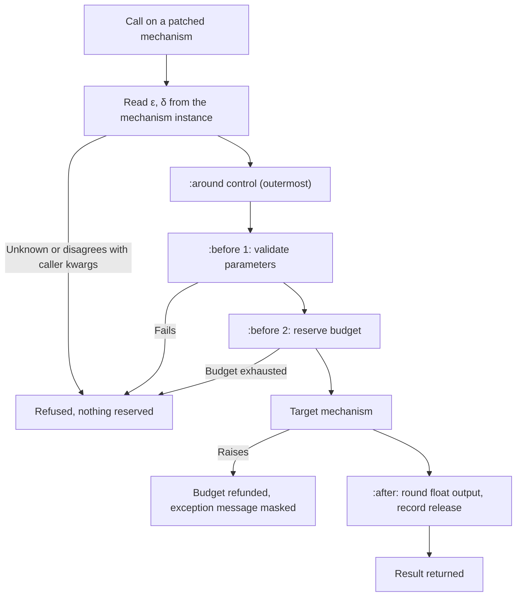

# DP-Advice Architecture & Policy Walkthrough: NIST SP 800-226 & W3C Privacy Principles

This document provides the rule mapping and architecture walkthrough for **DP-Advice**, an interception and compliance enforcement framework for Differential Privacy libraries modelled on the **LispWorks advice facility** (`defadvice`), with rules informed by **NIST SP 800-226** and the **W3C Privacy Principles**.

---

## 1. NIST SP 800-226 Rule Mapping

Rules are mapped to **NIST Special Publication 800-226** (*Guidelines for Evaluating Differential Privacy Guarantees*, March 2025, [doi:10.6028/NIST.SP.800-226](https://doi.org/10.6028/NIST.SP.800-226)). Citations were checked against the published PDF on 2026-10-13. Page numbers are the **printed** page numbers; add 10 for the PDF page index.

NIST SP 800-226 is guidance, not a set of numeric limits. On ε it says "we offer no specific guidelines on their selection" (§2.2, p. 14). The ε thresholds below (ε > 10, ε < 0.001) and N < 30 are therefore DP-Advice defaults, not NIST requirements. The δ thresholds (10⁻⁵ and 1/n²) are taken from NIST's own wording in §2.3.

**Support** column:

- **Direct**: the cited section states the concern.
- **Derived**: the rule follows from definitions or discussion in the cited section, but the rule wording, heuristic or threshold is ours.
- **Not in NIST**: the publication does not contain the rule; it needs a different source or should be dropped.

**Status** column: *linter* = implemented in `dp_advice/analyzer/static_linter.py` (17 rules, each with a positive and a negative test in `tests/test_linter.py`); *runtime* = enforced by the interception pipeline; *planned* = documented only, no code.

The linter resolves imports and dotted names to fully qualified names and matches those, so a user function that merely has "laplace" in its name is not treated as a mechanism. It remains heuristic: one flat symbol table, no control flow. Its verdict is REJECTED on any CRITICAL or HIGH finding, WARNING on MEDIUM, otherwise PASSED; LOW findings are informational.

| Rule | Severity | Status | Rule | NIST SP 800-226 basis (printed page) | Support |
| :--- | :--- | :--- | :--- | :--- | :--- |
| `NIST-WARN-09` | MEDIUM | linter | **Naive de-identification**: overwriting identifiers with static strings gives no DP guarantee. | §1.1, pp. 6–7: de-identified data remains open to linking attacks. | Direct |
| `NIST-ERR-05` | CRITICAL | planned | **Un-accounted interactive query**: DP query run outside a budget accountant. | §2.2, pp. 14–15 (composition, privacy budget); §4.1, p. 52 (budgeting for interactive queries). | Derived |
| `NIST-INFO-01` | LOW | planned | **Missing regulatory audit metadata**. | §1.3, p. 8 says meeting legal and regulatory requirements is out of scope. HIPAA and FERPA are not mentioned anywhere in the publication. | Not in NIST |
| `NIST-ERR-01` | CRITICAL | linter, runtime | **ε ≤ 0**. | §2.1.1, p. 11 (Definition 1); App. B.1, p. 75. | Derived |
| `NIST-ERR-06` | MEDIUM | linter | **δ > 0 passed to a Laplace mechanism**. Advisory: diffprivlib's `Laplace` accepts δ > 0 and then gives approximate DP. | App. B.2, p. 76: the Laplace mechanism guarantees (ε, 0)-DP. | Derived |
| `NIST-ERR-03` | CRITICAL | linter, runtime | **Budget exhaustion**: cumulative ε exceeds the configured budget. The linter sums ε over the releases it can resolve (a release in a loop counts once) and needs `total_budget`; the runtime accountant enforces it per call. | §2.1.2, p. 12 (composition); §2.2, pp. 14–15 (privacy budget); §4.1, p. 52. | Direct |
| `NIST-WARN-06` | HIGH | planned | **Post-processing that re-reads the raw data**. | §2.6, p. 28: post-processing that uses the original sensitive data "does not satisfy differential privacy". | Direct |
| `NIST-WARN-01` | HIGH | linter, runtime | **Large ε** (default threshold ε > 10). | §2.2, p. 14: ε < 1 is "reasonable"; ε of 10 or greater can leave outliers vulnerable. NIST sets no cap. | Derived |
| `NIST-WARN-05` | HIGH | linter, runtime | **Large δ**. Linter: δ > 10⁻⁵. Runtime: δ ≥ 1, or δ > 1/n² when the caller supplies a public n. | §2.3, pp. 16–17: set δ ≤ 1/n²; δ above 10⁻⁵ is "suspicious". §2.4.1, p. 21: do not derive δ from n under unbounded DP. | Direct |
| `NIST-WARN-03` | HIGH | linter | **Missing clipping bounds**: `diffprivlib.tools` call without `bounds`/`range`, or PyDP `Bounded*` without both bounds. | §3.4.2, p. 43; App. B.4, p. 77. | Direct |
| `NIST-WARN-04` | MEDIUM | linter | **Data-dependent sensitivity** (`max − min` of the private data). | §3.4.2, p. 43: bounds "must be given without looking at the data"; §3.4.4, p. 44. | Direct |
| `NIST-WARN-11` | HIGH | planned | **Bounded vs unbounded DP mismatch**. | §2.4.1, pp. 20–21. | Direct |
| `NIST-WARN-08` | MEDIUM | linter | **Group-by without contribution bounds**: a DP release inside a loop over `.groupby(...)`. Advisory. | §2.4.2, pp. 21–25 (bounding user contributions); App. B.3, p. 76. | Derived |
| `NIST-WARN-14` | LOW | planned | **Misleading ε after converting from zCDP with a large δ**. | §2.5, p. 27. | Direct |
| `NIST-WARN-12` | HIGH (exact statistic) / MEDIUM (dataset size) | linter | **Non-DP release alongside DP outputs**: `print`/`.write` of `len(...)`, `.shape`, or an exact NumPy/builtin statistic in a script that also makes DP calls. | §2.6, pp. 27–28. Note §2.4.1, p. 21: under bounded DP the dataset size may be released exactly. | Direct |
| `NIST-INFO-02` | LOW | planned | **Empirical privacy auditing**. | §2.7, p. 28: auditing can find bugs but cannot prove a guarantee. NIST does not prescribe membership-inference suites. | Direct |
| `NIST-ERR-02` | CRITICAL | linter | **Noise scale ≤ 0** in a recognized noise call (NumPy, `random.gauss`, OpenDP measurement). | App. B.2, p. 76 (Laplace scale Δ₁/ε). | Derived |
| `NIST-WARN-13` | MEDIUM | linter | **Very small ε** (default threshold ε < 0.001). | §2.2, p. 13 and §3.2, p. 31 (privacy–utility trade-off). | Derived |
| `NIST-WARN-15` | MEDIUM | planned | **Small subgroups** (default threshold N < 30). | §3.3.1, p. 36: DP can magnify disparate impact on small groups. | Derived |
| `NIST-WARN-16` | MEDIUM | planned | **Clipping bias**. | §3.4.2, p. 43; §3.3.3, p. 38. | Derived |
| `NIST-WARN-17` | LOW | planned | **Counting-query sensitivity**. | App. B.3, p. 76; §3.4.1, p. 40. | Direct |
| `NIST-WARN-18` | HIGH | planned | **Division by a noisy count**. | §3.4.3 does not discuss it. §4.3, p. 59 mentions divide-by-zero only as a backend side channel. | Not in NIST |
| `NIST-ERR-07` | CRITICAL | linter | **DP-SGD without per-example gradient clipping**: TensorFlow Privacy `DP*Optimizer` without `l2_norm_clip`, Opacus `make_private` without `max_grad_norm`. These API names were not checked against installed copies. | §3.5, p. 44; App. B.6, p. 79. | Direct |
| `NIST-WARN-19` | HIGH | planned | **Interactive endpoint without rate limiting**. | §4.1, pp. 51–52 covers budgeting for interactive queries; rate limiting is not mentioned. | Not in NIST |
| `NIST-INFO-03` | LOW | planned | **Central-model trust assumptions**. | §4.2.1, pp. 55–56. | Direct |
| `NIST-ERR-04` | CRITICAL | planned (`W3CEnforcer.enforce_trust_boundary` exists but nothing calls it) | **Local model declared but raw data sent to the curator**. | §4.2.2, p. 56. | Direct |
| `NIST-WARN-02` | MEDIUM | linter, runtime | **Fixed or reused PRNG seed**. Linter: integer `random_state`/seed. Runtime: an integer `random_state` on the mechanism instance may not be reused. | The word "seed" does not appear in the publication. §4.3 covers floating point, timing channels, backend issues and hyperparameter tuning. | Not in NIST |
| `NIST-WARN-07` | LOW | linter | **Floating-point noise**: informational note on continuous Laplace/Gaussian mechanisms; does not affect the verdict. | §4.3, pp. 58–59; App. B.7, p. 79. NIST says maintained libraries generally handle this and are safer than custom code; it does not prescribe snapping. | Direct |
| `NIST-ERR-08` | CRITICAL | planned | **Direct access to raw data from user code**. | §4.4, pp. 60–61 covers data security and access control in general terms. | Not in NIST as a rule |
| `NIST-WARN-20` | MEDIUM | planned | **Persisting intermediate raw data**. | §4.4, p. 60 (protect data at rest); §4.5, p. 61 (minimise collection). | Derived |
| `NIST-WARN-21` | LOW | linter | **L2 sensitivity for Gaussian mechanisms**: informational reminder; the linter cannot tell which norm a number is. | §3.1, p. 30; App. B.2, pp. 75–76. | Direct |
| `NIST-WARN-22` | HIGH | planned | **DP-SGD noise multiplier bound** σ ≥ √(2 ln(1.25/δ))/ε. | This formula is not in the publication. App. B.2, p. 76 states the Gaussian mechanism with the analytic (Φ-based) condition. | Not in NIST |
| `NIST-WARN-23` | MEDIUM | linter | **Custom noise implementation**: `numpy.random.laplace/normal`, generator `.laplace/.normal`, `random.gauss`. | §3.4, p. 40; §4.3, p. 58; App. B.7, p. 79. | Direct |

---

## 2. W3C Privacy Principles: Interpretive Mapping

This table relates DP-Advice features to the **W3C Privacy Principles** ([https://www.w3.org/TR/privacy-principles/](https://www.w3.org/TR/privacy-principles/), W3C Statement, 15 May 2025). Quotations were checked against the published text on 2026-10-13.

The principles address websites, user agents and web API designers. They do not mention differential privacy, floating-point arithmetic, exception handling or trust boundaries. The last column is therefore our interpretation of how a DP-Advice feature serves the spirit of a principle; the W3C document does not require or describe any of these mechanisms. Principles are numbered, not titled, in the source; the short titles are ours.

The separate W3C Group Note Draft *Considerations for Reviewing Differential Privacy Systems* ([https://www.w3.org/TR/differential-privacy-guidance/](https://www.w3.org/TR/differential-privacy-guidance/), 12 February 2026) does cover central and local trust models (§4.1). It is an unendorsed draft and deliberately does not discuss mechanisms.

| W3C Section # | W3C Principle (short title ours) | W3C Text | Our interpretation in DP-Advice |
| :--- | :--- | :--- | :--- |
| **Section 1.5** | **Principle 1.5.1: Pareto Frontier** | *"When confronted with an apparent tradeoff, first look for ways to improve all principles at once."* | **DP-Advice** aims to apply privacy checks without changing the analyst's code, so adding enforcement need not cost usability. It does not resolve the privacy–utility trade-off. |
| **Section 1.5** | **Principle 1.5.2: Limited Collection for Safety** | *"If a service needs to collect extra data... it must take extra technical and legal measures to ensure that this data can't be then used for other purposes."* | **`NIST-WARN-20`** (planned, not implemented) would flag code that persists unperturbed raw datasets. |
| **Section 2.1** | **Principle 2.1: Identity per Context** | *"A user agent should help its user present the identity they want in each context they are in, and should prevent or support recognition as appropriate."* | **`NIST-WARN-09` & `NIST-WARN-08`** flag naive string replacements (e.g. `df['name'] = 'Anonymous'`) and group-by loops. They warn; they do not prevent linkage. |
| **Section 2.2** | **Principle 2.2.1: Restrict Data to Necessary or Aligned** | *"Sites, user agents, and other actors should restrict the data they transfer to what's either necessary to achieve their users' goals..."* | `NISTEnforcer.clamp_dataset_bounds(data, L, U)` clips data values to the minimal necessary domain $[L, U]$ before mechanism execution. |
| **Section 2.2** | **Principle 2.2.2: Granular API Data Requests** | *"Web APIs should be designed to minimize the amount of data that sites need to request to carry out their users' goals."* | **`NIST-WARN-03` (Unbounded Sensitivity / Missing Clamping)** flags queries that attempt to process unconstrained dataset fields without explicit parameter bounds. |
| **Section 2.2.1.1** | **Principle 2.2.1.1.1: Ancillary APIs & Info Leaks** | *"Ancillary APIs that provide new information should not reveal any personal data that isn't already available..."* | **`NIST-WARN-12` (Auxiliary Raw Data Release Side-Channel)** detects scripts that print or export unperturbed exact row counts or raw dataset statistics alongside DP outputs. |
| **Section 2.3** | **Principle 2.3: Information Access / Deprecated APIs** | *"New web APIs should guard users' information at least as well as existing APIs..."* | **`NIST-WARN-07` (Unsanitized IEEE 754 Floating-Point Noise)** flags continuous Laplace and Gaussian outputs that may be exposed to the floating-point attack described by Mironov (2012). The principle itself concerns new web APIs; the link to floating-point noise is our analogy. |
| **Section 2.4** | **Principle 2.4: Sensitive Information Contextuality** | *"...system designers should not assume that other categories of information are therefore not sensitive."* | **`NIST-WARN-15`** (planned, not implemented) would flag queries over small subgroups, where DP noise has a disproportionate effect. |
| **Section 2.5** | **Principle 2.5: Respect Data Rights** | *"People have certain rights over data that is about themselves, and these rights should be facilitated..."* | **`NIST-ERR-03` & Global Privacy Accountant** track sequential composition ($\sum \epsilon_i \le \mathcal{E}_{\max}$) for intercepted calls within one process. The bound holds only if every release goes through an intercepted mechanism and the reported ε is the one the mechanism used. |
| **Section 2.6** | **Principle 2.6: Work with De-identified Data** | *"Whenever possible, processors should work with data that has been de-identified."* | Related in spirit: DP-Advice checks code that uses differential privacy libraries. Note that NIST SP 800-226 §1.1 distinguishes differential privacy from de-identification. |
| **Section 2.10** | **Principle 2.10.1 & 2.10.2: Purpose Specification & No Secondary Use** | *"Actors should not use personal data for purposes other than those specified."* | **`NIST-ERR-04` & `NIST-ERR-08`** (planned, not implemented) would flag code that bypasses the DP mechanism to reach raw data. |
| **Section 2.11** | **Principle 2.11.1: Transparency When Requested** | *"...sites (and other actors) should provide people with relevant explanatory information about the use of data..."* | **"Mathematical Formulas & Individual Calculations"** UI card displays instantiated KaTeX formulas ($\sigma$, $b$, clamped input $x'$, drawn noise, release) to explain each calculation. |
| **Section 2.11** | **Principle 2.11.2: Plain Language & Machine-Readable Form** | *"Information about privacy-relevant practices should be provided in both easily accessible plain language form and in machine-readable form."* | The audit logger writes machine-readable JSONL (`audit_logs/dp_compliance_audit.jsonl`) and the dashboard shows a human-readable table. The log is a plain append-only file with no integrity protection. |
| **Section 2.11** | **Principle 2.11.3: Visible & Distinguishable Operation** | *"Mechanisms that can be used for recognizing people should be designed so that their operation is visible and distinguishable..."* | **Advice Execution Pipeline Visualizer** renders every execution step (`:before`, `:around`, `Target Mechanism`, `:after`) as a distinct, color-coded stage. |

---

## 3. Advice Pipeline Architecture

**DP-Advice** follows the LispWorks advice facility (`defadvice` with `:before`, `:around`, `:after` and `call-next-advice`). One deliberate difference: here `:after` advice receives the result and may replace it.

For a patched mechanism the standard advices run in this order:

- **Parameters come from the instance.** ε and δ are read from the mechanism object at call time. A caller keyword that disagrees raises `ParameterMismatchError`. If ε cannot be determined the call raises `UnknownPrivacyParametersError` (fail closed).
- **Refund caveat.** A failed call is refunded because nothing was released. If a mechanism can fail depending on the data, the failure itself is observable (NIST SP 800-226 §4.3, p. 59), so refunds are only sound for data-independent failures.
- **Output rounding is not snapping.** `W3CEnforcer.round_output` rounds floats to a 2⁻⁴⁰ grid. It is not Mironov's snapping mechanism and is not a floating-point attack mitigation. For real snapping use `diffprivlib.mechanisms.Snapping`, which the dashboard offers.
- **Accounting is basic sequential composition**, in memory, per process.
- **Patching** is idempotent and reversible: `patch_dp_mechanism`, `unpatch_dp_mechanism`, `unpatch_all`.

---

## 4. Library Interception: Current State

Nothing is patched automatically on import.

| Library | What exists today |
| :--- | :--- |
| **IBM diffprivlib mechanisms** | Any mechanism class can be patched with `patch_dp_mechanism(cls, "randomise", key)`; parameters are read from the instance. Tested with `Laplace`, `GaussianAnalytic` and `Geometric`. The dashboard runs `Laplace`, `GaussianAnalytic`, `Geometric` and `Snapping` through the same pipeline via `run_dp_call`. |
| **Function-style APIs** (e.g. `diffprivlib.tools`) | Supported in principle with `param_source="kwargs"`, which requires an `epsilon` keyword. Not tested against `diffprivlib.tools` itself. |
| **OpenDP, PyDP, TensorFlow Privacy, Opacus** | Not intercepted at runtime. The static linter recognizes some of their calls by name. |
| **pandas** | Not supported. An earlier version charged budget for `DataFrame.mean` without adding noise; that was removed. |

---

Access the Web Dashboard:
👉 **[http://localhost:8001](http://localhost:8001)** (the port mapped in `docker-compose.yml`)
